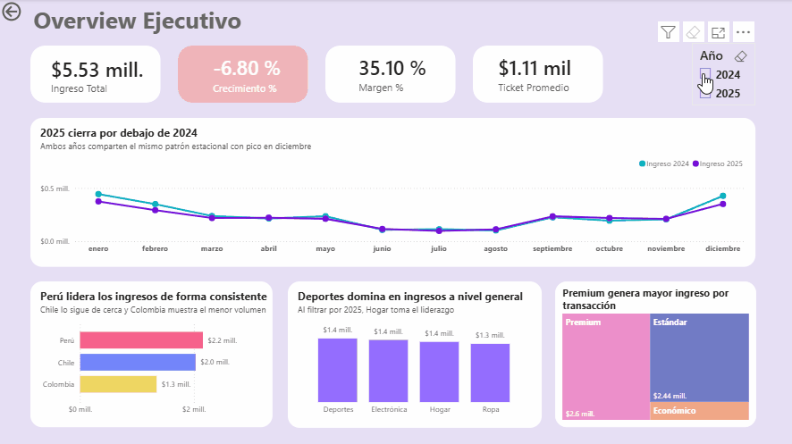
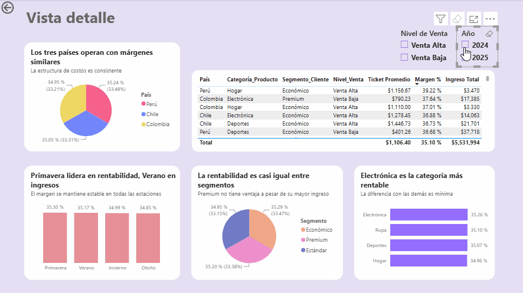

# 📊 Dashboard de Desempeño Comercial 2024–2025 — Andes Retail Group
 
> Dashboard ejecutivo en Power BI que consolida el desempeño comercial de una cadena retail operando en Perú, Chile y Colombia, para apoyar decisiones estratégicas de dirección.
 
---
 
## 📌 Contexto
 
Andes Retail Group es una empresa de retail con operaciones en Perú, Chile y Colombia, que comercializa en cuatro categorías: 
🖥️ Electrónica, 👕 Ropa, ⚽ Deportes y 🏠 Hogar.
 
La dirección ejecutiva necesitaba un **dashboard interactivo** para entender el desempeño comercial 2024–2025. La información estaba dispersa en datos transaccionales, sin una vista clara que respondiera preguntas estratégicas de negocio.
 
**💡 Preguntas de negocio**
- ¿Cómo ha evolucionado el ingreso total entre 2024 y 2025?
- ¿Qué segmentos de clientes aportan mayor ingreso y rentabilidad?
- ¿Qué categorías de producto tienen mayor impacto en el negocio?
- ¿Existen diferencias relevantes entre países o regiones?
- ¿Qué patrones temporales se observan a lo largo del año?
- ¿Dónde podrían existir oportunidades de mejora comercial?
---
 
## 🛠️ Stack
 
| Herramienta | Uso |
|---|---|
| 📊 Power BI Desktop | Modelado y construcción del dashboard |
| 🔧 Power Query | Limpieza, tipado de datos y columna condicional (`Nivel_Venta`) |
| 📐 DAX | Cálculo de KPIs (crecimiento %, margen, ticket promedio) |
 
---
 
## 📁 Estructura del repositorio
 
```
andes-retail-performance-dashboard/
│
├── 📊 dashboard/
│   └── andes_retail_dashboard.pbix
│
├── 🖼️ img/
│   ├── dashboard_acapital.gif                  # Vista Overview Ejecutivo
│   └── details_acapital.gif                    # Vista Detalle
│
└── 📝 README.md
```
 
---
 
## 📊 Visualizaciones
 



 
---
 
## 🔍 Decisiones clave
 
- 🎯 **Elección de gráfico por pregunta, no por costumbre.** Ej. pastel para Margen % por país y por segmento, porque los valores eran casi idénticos entre categorías (~34%) y el pastel comunica equilibrio proporcional mejor que unas barras, que habrían sugerido una disparidad que no existe.
- 🌎 **Barras horizontales en vez de mapa geográfico** para comparar países: con solo tres países (Perú, Chile, Colombia), un mapa proporcional dejaría demasiado espacio vacío, además de las limitaciones del visual de mapa en la versión gratuita de Power BI Desktop.
- 🖱️ **Interactividad como parte del diseño, no como extra:** el gráfico de pastel por país en la Vista Detalle actúa como filtro cruzado — al hacer clic en un país, toda la página se actualiza sin necesidad de un slicer adicional.
- 🎨 **Jerarquía de color intencional:** la tarjeta de Crecimiento % usa color de alerta para dirigir la atención de la dirección al dato negativo (-6.80%) de forma inmediata.
---
 
## 📈 Hallazgos principales
 
**1️⃣ Los ingresos cayeron -6.80%, con cambio de liderazgo en categorías**
Deportes dominaba en 2024, pero Hogar tomó el primer lugar en 2025. Perú lidera geográficamente de forma consistente en ambos años.
 
**2️⃣ Lo que más vende no es lo más rentable**
Electrónica y Ropa lideran en margen (35%+) aunque no en volumen de ventas — una desconexión entre ingreso y rentabilidad que la vista de ingresos por sí sola no revela.
 
**3️⃣ El margen es sorprendentemente uniforme (~34%) sin importar país, segmento o estación**
Esto sugiere que las oportunidades de mejora no están en eficiencia de costos, sino en el mix de producto y segmento.
 
**4️⃣ El segmento Premium no tiene ventaja de rentabilidad, a pesar de su ticket promedio más alto**
Genera tres veces más ingreso por transacción que el segmento Económico ($1,700 vs $508), pero opera con el mismo margen (~34%) — lo que invita a cuestionar si los costos de retención de ese segmento están justificados frente al resultado en rentabilidad.
 
---
 
## 💬 Resumen ejecutivo (mensaje tipo Slack)
 
> **Situación:** Consolidamos el desempeño comercial 2024–2025 en Perú, Chile y Colombia.
>
> **Complicación:** Los ingresos cayeron -6.80% en 2025, con cambio de liderazgo en categorías. Más relevante aún: las categorías que más venden *no son* las más rentables.
>
> **Pregunta clave:** ¿Dónde están las oportunidades si el margen es uniforme (~34%) sin importar país, segmento o estación?
>
> **Acciones recomendadas:**
> - 📈 Potenciar Electrónica y Ropa — mayor margen, menor protagonismo comercial actual.
> - 🎯 Estrategia de upselling en el segmento Estándar, que lidera en volumen con recorrido al alza en ticket promedio.
> - 🔍 Revisar la rentabilidad real del segmento Premium ($1,700 de ticket promedio) frente a sus costos de retención.
> - 📅 Reforzar acciones comerciales en junio–julio, valle estacional consistente en ambos años.
 
---
 
## 🔗 Enlaces
 
- 📘 [Caso completo con contexto de negocio →](https://app.notion.com/p/Gabriela-Triana-BI-Analyst-Power-BI-aadd07c9675c824bbe1001f9ba9db7b9?source=copy_link)
- 💼 [LinkedIn](https://www.linkedin.com/in/gabriela-triana-data-analyst/)
